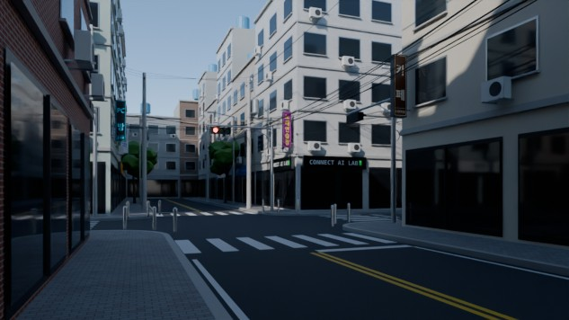
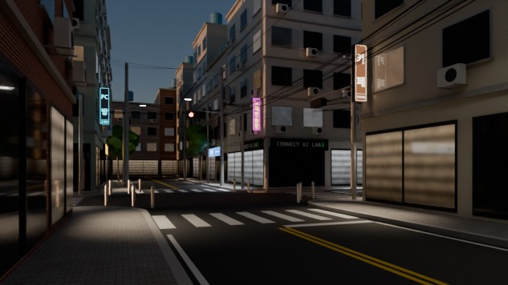
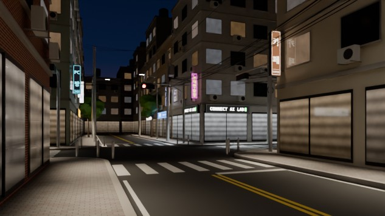
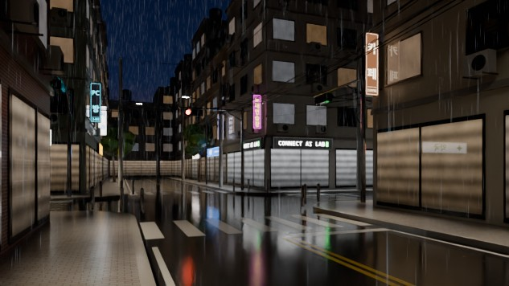

# 서울 골목 사거리 — 낮 → 밤 → 비, 14초 원테이크

가상의 서울 골목 사거리 하나를 블렌더 Python으로 만들고, 같은 장면에서 빛과 날씨만 바꿔 14초(24fps, 336프레임) 원테이크를 만듭니다.
실존 상호와 브랜드는 쓰지 않습니다.

| 낮 (2.0초) | 해질녘 전환 (4.9초) |
| --- | --- |
|  |  |
| **밤 (7.5초)** | **비 오는 밤 (12.5초)** |
|  |  |

위 이미지는 640×360(33%), Cycles 32샘플로 렌더한 확인용 스틸입니다.

## 파일

| 파일 | 하는 일 |
| --- | --- |
| [`make_signs.py`](make_signs.py) | PIL로 한글 간판 텍스처를 만듭니다. 세로 5개, 가로 7개, `CONNECT AI LAB` 1개입니다. |
| [`signs/`](signs/) | 만들어 둔 간판 PNG와 목록 `signs.json`. 나눔고딕 ExtraBold로 만들었습니다. |
| [`seoul_crossroad.py`](seoul_crossroad.py) | 장면 전체를 만드는 블렌더 스크립트. 상태 채널, 드라이버, 비, 카메라, 렌더 설정까지 포함합니다. |
| [`run_in_blender.py`](run_in_blender.py) | 블렌더 MCP 애드온으로 장면 스크립트를 보내 지금 열린 블렌더에 장면을 만듭니다. |
| [`previews/`](previews/) | 확인용 저해상도 스틸 |

## 실행 방법

먼저 저장소를 내려받습니다. 간판 이미지가 함께 있어야 합니다.

```bash
git clone https://github.com/spacypym8916-cmd/spacy.git
```

```bash
cd spacy
```

### 1. 블렌더 MCP로 (권장)

블렌더를 켜 두고, `N` 패널 **MCP for Blender** 탭에 `Connected on localhost:9876`이 보이는 상태에서 실행합니다.

```bash
uv run blender/run_in_blender.py
```

블렌더에 새 장면 `SeoulCrossroad`가 생기고 그 장면으로 바뀝니다. 기존 장면은 그대로 둡니다.
스페이스바로 재생하고, `F12`로 현재 프레임을 렌더합니다.

낮·밤·비 저해상도 스틸까지 바로 받으려면 저장할 폴더를 지정하세요. 렌더하는 동안 블렌더 화면이 몇 분 멈춥니다.

```bash
uv run blender/run_in_blender.py --stills ~/Desktop/seoul_stills
```

### 2. 블렌더 Scripting 탭에서

블렌더 **Scripting** 탭에서 `blender/seoul_crossroad.py`를 열고 **Run Script**를 누릅니다.
간판은 스크립트 옆 `signs/` 폴더에서 찾습니다.

### 3. 화면 없이 (백그라운드)

```bash
blender -b -P blender/seoul_crossroad.py -- --stills out --percent 33
```

`.blend`로 저장한 뒤 14초 전체를 렌더하려면 이렇게 합니다.

```bash
blender -b -P blender/seoul_crossroad.py -- --save seoul_crossroad.blend
```

```bash
blender -b seoul_crossroad.blend -a
```

| 옵션 | 설명 |
| --- | --- |
| `--stills 폴더` | 낮(2.0초)·밤(7.5초)·비(12.5초) 스틸을 저장합니다. |
| `--only day dusk night rain` | 렌더할 스틸 고르기. `dusk`는 해질녘 전환(4.9초)입니다. |
| `--percent 33` | 스틸 해상도 비율 (기본 33% = 640×360) |
| `--samples 32` | 스틸 샘플 수 (기본 32) |
| `--save 경로.blend` | 만든 장면을 `.blend`로 저장합니다. |
| `--signs 폴더` | 간판 폴더를 직접 지정합니다. |

### 간판 다시 만들기

```bash
uv run blender/make_signs.py
```

시스템의 한글 글꼴을 자동으로 찾습니다. Mac은 Apple SD 산돌고딕 Neo, Windows는 맑은 고딕, Linux는 나눔·Noto CJK를 씁니다.
글꼴을 직접 고르려면 `--font 경로.ttf`를 붙이세요.

## 타임라인

| 시간 | 장면 | 상태 채널 |
| --- | --- | --- |
| 0 ~ 3.5초 | 낮. 물리 하늘, 해 고도 34° | `sun` 1 |
| 3.5 ~ 6초 | 타임랩스 전환. 해가 지며 그림자가 쓸려가고 노을이 집니다. 간판이 하나씩, 창문은 무작위 순서로 켜집니다. | `sun` 1 → 0, `night` 0 → 1 |
| 6 ~ 9초 | 밤. 도시 불빛이 비치는 남색 하늘. 가로등과 가게 불빛이 보도에 떨어집니다. | `night` 1 |
| 9 ~ 10.5초 | 비 시작. 빗줄기가 생기고, 도로가 젖어 어두워지며 광택이 나고, 웅덩이에 파문이 생깁니다. | `rain` 0 → 1, `wet` 0 → 1 |
| 10.5 ~ 14초 | 비 오는 밤. 젖은 도로에 간판, 특히 `CONNECT AI LAB`이 반사됩니다. | 모두 유지 |

키프레임은 베지어(자동 클램프)라서 전환이 부드럽습니다.
해 고도는 `-8 + 42 × sun`도입니다. 4.5초에 9.6°, 5.2초에 0.4°(일몰), 6초에 -8°가 됩니다.

## 상태 채널과 드라이버

`SC_CTRL` 엠프티의 커스텀 속성 `night`, `rain`, `wet`, `sun`에만 키프레임이 있습니다.
모든 재질과 조명이 드라이버로 이 값을 읽습니다. 재질 54개, 조명 56개, 드라이버 140개입니다.

- **해:** `sun` → 하늘의 해 고도·방위, 태양 램프의 세기·색·방향
- **하늘:** `sun`·`night` → 물리 하늘과 남색 밤하늘(지평선 쪽 도시 불빛)의 섞임
- **간판:** `night`가 간판마다 다른 문턱을 넘으면 하나씩 켜집니다. `CONNECT AI LAB`이 마지막으로 켜집니다.
- **창문·쇼윈도:** 면마다 저장한 문턱(`lit_th`)·색(`tint`)·밝기(`bright`) 속성을 읽어 무작위 순서로 켜집니다.
- **가로등·가게 조명:** `night`에 따라 켜집니다.
- **모든 표면:** `wet`에 따라 어두워지고 광택이 납니다.
- **아스팔트:** `wet`에 따라 웅덩이가 넓어지고, `rain`에 따라 빗방울 파문이 생깁니다.
- **빗줄기:** `rain`이 지오메트리 노드의 밀도 입력과 재질 불투명도를 움직입니다.
- **카메라 노출:** `night`에 따라 조금 올라갑니다. 타임랩스 카메라의 자동 노출 같은 효과입니다.

드라이버는 모두 블렌더의 단순식이라서, 파이썬 자동 실행(Auto Run Python Scripts)을 켜지 않아도 동작합니다.
스크립트가 끝날 때 드라이버 없는 재질·조명이 없는지와 단순식이 아닌 드라이버 개수를 출력합니다.

## 장면 구성

- **건물:** 4~6층 상가건물 45동. 외장은 타일 3종, 벽돌 2종, 미장 3종을 섞었습니다. 쇼윈도, 층 띠, 창틀, 실외기, 옥상 물탱크가 있습니다.
- **길:** 왕복 2차로 아스팔트, 횡단보도 줄무늬 네 방향, 정지선, 중앙 황색 복선, 화강석 연석, 보도블록, 둥근 모퉁이
- **전기·통신:** 콘크리트 전봇대 11개, 완금과 애자, 고압선, 엉킨 통신선 다발과 감아 둔 여유선, 건물로 들어가는 인입선, 주상변압기 2대
- **거리:** 가로로 걸린 3구 신호등, LED 가로등, 가로수와 보호덮개, 스테인리스 볼라드
- **간판:** PIL로 만든 한글 간판. 세로 간판은 카페·피아노학원·치과·노래연습장·PC방, 가로 간판은 분식·마트·세탁·약국·치킨·꽃집·부동산입니다. 모퉁이 1층 가게는 검정 바탕에 흰 글자, 초록 커서의 `CONNECT AI LAB`입니다.
- **비:** 지오메트리 노드. 격자 위에 점을 뿌리고, 각 점의 높이를 `씬 시간 × 9m/s`로 떨어뜨려 반복합니다. 밀도는 `rain`이 정합니다. 모션블러가 끊기지 않도록 점 개수는 그대로 두고, 보이지 않는 점은 크기를 0으로 줄입니다.
- **카메라:** 남서쪽 보도, 눈높이 1.6m, 26mm. 모퉁이 건물을 3/4로 잡고 14초 동안 2.6m를 일정한 속도로 밀고 들어갑니다. 세로선이 기울지 않게 카메라는 수평으로 두고 렌즈 시프트로 구도를 맞춥니다.

## 렌더 설정

Cycles 32샘플, 적응형 샘플링(임계값 0.02), OIDN 디노이즈, 모션블러(셔터 0.5), AgX, 1920×1080, 24fps.

## 확인한 것과 한계

- 리눅스 컨테이너의 블렌더 5.2.3(pip `bpy` 모듈, 화면 없음)에서 장면을 만들고 낮·해질녘·밤·비 스틸과 13프레임 타임라인을 렌더해 확인했습니다.
- `run_in_blender.py`는 MCP 애드온과 똑같이 코드를 실행하는 가짜 애드온으로 확인했습니다. 성공했을 때와 블렌더 오류가 났을 때 모두 확인했습니다.
- 블렌더 화면(UI)이나 Mac·Windows의 실제 블렌더에서는 아직 실행해 보지 않았습니다.
- 블렌더 4.2~4.5 호환 코드(하늘 종류 이름, 지오메트리 노드 입력 방식)를 넣었지만 4.x에서는 실행해 보지 않았습니다.
- 렌더 시간: CPU 4코어에서 640×360 한 장에 약 20~25초 걸렸습니다. 1920×1080은 픽셀이 9배라서 14초 전체(336프레임)는 GPU 렌더를 권합니다.
- 건물은 상자에 파사드 디테일을 붙인 형태입니다. 웅덩이와 빗방울 파문은 시뮬레이션이 아니라 셰이더로 만든 것입니다.
